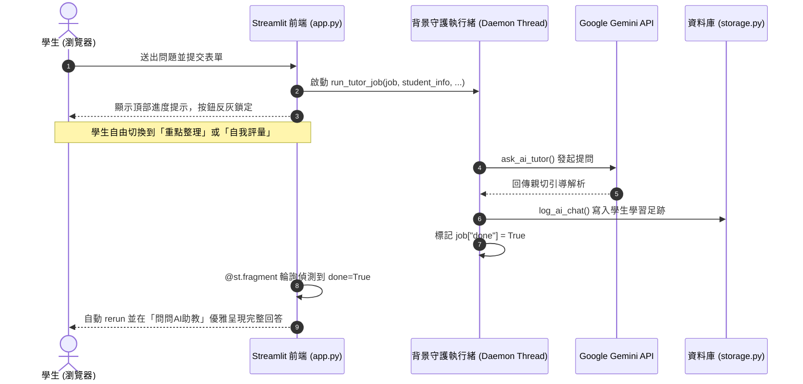

# 📑 CivilEdu_AI — 2026-11-10 本日完整開發紀錄檔 (Development Log)

**專案名稱**：CivilEdu_AI 國中公民思辨星系 ｜ AI 智慧自主學習館  
**開發日期**：2026-11-10  
**核心主題**：遠端專案進度同步、Supabase 雲端持久化儲存架構、AI 助教背景執行緒非同步應答機制、行動端手勢縮放/拖曳互動心智圖、資料庫斷線安全提示與測驗交卷單次防灌水機制  
**版本標籤**：`2026-11-10-v1` (階段 26～31)  

---

## 🎯 一、 今日開發與同步里程碑總覽 (Milestones Summary)

今日（2026-11-10）完成本機工作目錄與遠端 GitHub 儲存庫（`https://github.com/SevynLee777/CivilEdu_AI.git`）之全量進度同步（自 Commit `dc4222f` 快進至最新 Commit `572c6ce`），全面整合近期關鍵架構重構與使用者體驗升級：

| 階段編號 | 核心主題 | 影響檔案 | 核心技術與成果摘要 |
| :---: | :--- | :--- | :--- |
| **階段 26** | **Supabase 雲端持久化儲存** | [`storage.py`](file:///C:/Users/awen8/CivilEdu_AI/storage.py)<br>[`docs/supabase_setup.sql`](file:///C:/Users/awen8/CivilEdu_AI/docs/supabase_setup.sql)<br>[`logger_utils.py`](file:///C:/Users/awen8/CivilEdu_AI/logger_utils.py)<br>[`unit_manager.py`](file:///C:/Users/awen8/CivilEdu_AI/unit_manager.py) | 建立雙模資料持久層（本地 JSON 與 Supabase PostgreSQL）。徹底解決 Streamlit Community Cloud 在重啟或重新部署時檔案系統還原導致的教材與學生歷程遺失問題；搭配 RLS 安全存取政策。 |
| **階段 27** | **AI 助教背景執行緒非同步回答** | [`app.py`](file:///C:/Users/awen8/CivilEdu_AI/app.py)<br>[`unit_manager.py`](file:///C:/Users/awen8/CivilEdu_AI/unit_manager.py) | 將學生提問改由背景守護執行緒（Daemon Thread）處理，配合 `@st.fragment(run_every=2)` 局部輪詢更新。學生切換分頁時運算不再被中斷，防止提問遺失與畫面白等。 |
| **階段 28** | **行動端手勢縮放/拖曳互動心智圖** | [`mindmap_view.py`](file:///C:/Users/awen8/CivilEdu_AI/mindmap_view.py)<br>[`app.py`](file:///C:/Users/awen8/CivilEdu_AI/app.py)<br>[`requirements.txt`](file:///C:/Users/awen8/CivilEdu_AI/requirements.txt) | 封裝全新 `mindmap_view.py` 檢視模組，支援雙指捏合縮放 (Pinch-to-zoom)、單指放大後拖曳平移 (Pan)、桌面 Ctrl+滾輪縮放與右上角按鈕控制；嚴格啟用 Mermaid strict 模式防止 XSS。 |
| **階段 29** | **AI 生成品質強化與 Word 表格解析** | [`unit_manager.py`](file:///C:/Users/awen8/CivilEdu_AI/unit_manager.py) | 1. 讀取 `.docx` 時依照文件流順序完整納入表格文字。<br>2. 自動檢核題目標籤補強內容完整性，缺少時自動觸發二次補生成。<br>3. 提示詞限縮心智圖為樹狀結構與 15 節點內，增強模型忙碌重試與空回應處理。 |
| **階段 30** | **交卷單次寫入防灌水與連線異常防護** | [`app.py`](file:///C:/Users/awen8/CivilEdu_AI/app.py)<br>[`logger_utils.py`](file:///C:/Users/awen8/CivilEdu_AI/logger_utils.py)<br>[`storage.py`](file:///C:/Users/awen8/CivilEdu_AI/storage.py) | 1. 測驗交卷結果快取化，防止畫面重複 rerun 導致歷史紀錄與練習次數灌水。<br>2. 資料庫連線異常時提供即時警示，不以空白資料覆蓋雲端歷程，亦不誤顯示「尚未練習」。 |
| **階段 31** | **GitHub Actions 保活與架構流程圖精簡** | [`.github/workflows/supabase-keepalive.yml`](file:///C:/Users/awen8/CivilEdu_AI/.github/workflows/supabase-keepalive.yml)<br>[`docs/`](file:///C:/Users/awen8/CivilEdu_AI/docs/)<br>[`README.md`](file:///C:/Users/awen8/CivilEdu_AI/README.md) | 1. 建立 GitHub Actions 每日定時 3 次排程查詢，防止 Supabase 免費專案因 7 天閒置而暫停。<br>2. 拆分 README 龐大流程圖為「系統總覽」、「學生流程」、「教師流程」三張圖資，並新增系統架構圖（含 Mermaid、PNG、SVG）。 |

---

## ☁️ 二、 階段 26：Supabase 雲端持久化儲存架構

### 1. 遭遇挑戰與問題剖析
Streamlit Community Cloud 採用輕量化容器虛擬化架構，每次專案重啟、代碼更新重新部署或休眠復甦時，容器檔案系統均會重置為 Git 倉庫初始狀態。過去產生的 `units_db.json`（教師新增修改之教材）與 `student_logs/`（學生作答足跡）將面臨無情抹除，嚴重影響真實教學現場的連續性。

### 2. 架構解決方案：雙模資料層設計
新架構新增 [`storage.py`](file:///C:/Users/awen8/CivilEdu_AI/storage.py)，支援「環境自動偵測」：
- **遠端模式 (Supabase PostgreSQL)**：當檢測到環境變數或 `st.secrets` 中具備 `SUPABASE_URL` 與 `SUPABASE_KEY` 時，教材與學生足跡全面寫入 Supabase。
- **本機模式 (Local JSON)**：未設定連線金鑰時，無縫降級回退使用既有的本機 `units_db.json` 與 `student_logs/`，本地單機離線開發測試零負擔。

```mermaid
flowchart TD
    App["CivilEdu_AI 應用層 (app.py)"] --> Manager["教材/紀錄管理 (unit_manager / logger_utils)"]
    Manager --> Storage{"storage.is_remote()"}
    Storage -->|是 (已設定 SUPABASE_KEY)| Supa["Supabase 雲端資料庫 (PostgreSQL REST API)"]
    Storage -->|否 (本機環境)| Local["本機檔案 (units_db.json / student_logs/)"]
    Supa --> Table1["public.units (教材單元)"]
    Supa --> Table2["public.student_records (學生作答歷程)"]
```

### 3. 資料庫結構與安全防護 ([`docs/supabase_setup.sql`](file:///C:/Users/awen8/CivilEdu_AI/docs/supabase_setup.sql))
- 資料表設計：`units` 與 `student_records` 均採用 `id (TEXT)` 主鍵搭配 `data (JSONB)` 儲存結構，兼具關聯式資料庫之效能與 NoSQL 文檔之彈性。
- **資料保護 (RLS)**：資料表全面開啟 Row Level Security (RLS) 且不賦予公開讀寫原則，僅允許系統後端透過 service_role 金鑰存取，徹底保障學生個人學習隱私。

---

## 🧵 三、 階段 27：AI 助教背景執行緒應答與防中斷機制

### 1. 痛點分析
呼叫 Gemini 進行大模型推論與白話教學引導通常耗時 10～20 秒。在原先的 Streamlit 單執行緒運行架構下，若學生在等待回答期間切換至其他標籤頁（例如去看重點講義或做題目），Streamlit 會立即中斷當前腳本的執行流程，導致生成中的回答遭到遺棄，學生切回分頁時提問視窗被重置為空白。

### 2. 背景非同步常駐執行緒架構 ([`app.py`](file:///C:/Users/awen8/CivilEdu_AI/app.py#L25-L65))
- **常駐執行緒**：將學生提問包裝為獨立 Job 物件，透過 `threading.Thread(target=run_tutor_job, daemon=True)` 移至背景執行緒獨立運算，不受 Streamlit 頁面重新渲染影響。
- **局部無感輪詢**：運用 `@st.fragment(run_every=2)` 每 2 秒微型檢查 Job 狀態，完成後觸發 `st.rerun()`，將回答安全寫入學生歷程並呈現於畫面上。
- **防重複提問表單**：提問區域改採 `st.form` 包裝，在 AI 回答期間自動鎖定提交按鈕，頂部橫幅清晰提示：「💬 AI 助教正在組織回答，大約需要 20 秒。可以先看其他內容...」。



---

## 🗺️ 四、 階段 28：行動端手勢縮放/拖曳互動心智圖模組

### 1. 痛點剖析
國中學生與教師大量使用平板或智慧型手機登入系統，而原本靜態渲染的 Mermaid 心智圖在小螢幕上字體極小且難以辨識；若直接放大整個網頁，又會造成頁面排版跑版或影響主卷軸滾動。

### 2. 獨立封裝 `mindmap_view.py` ([`mindmap_view.py`](file:///C:/Users/awen8/CivilEdu_AI/mindmap_view.py))
- **Pointer Events 手勢核心**：
  - **雙指捏合縮放 (Pinch-to-zoom)**：精準計算兩指距離與中點進行等比例縮放。
  - **單指拖曳平移 (Pan)**：未放大時維持單指滑動滾動網頁；放大後自動鎖定為畫布抓取拖曳 (`cursor: grab`)。
  - **桌面滑鼠支援**：支援 `Ctrl + 滾輪` 縮放，以及右上角實體輔助按鈕（`＋` 放大、`－` 縮小、`⟲` 重設最適大小）。
- **安全隔離防護**：
  - 心智圖由 AI 自動產生，為防範潛在 XSS 攻擊，圖資以 JSON 字串型態傳入 HTML，並強制啟用 Mermaid 的 `securityLevel: 'strict'` 模式清理標籤。
  - 整合 `ResizeObserver`：解決 Streamlit 分頁初始隱藏時容器寬度為 0 導致 Mermaid 計算版面錯誤的問題。

---

## 🛡️ 五、 階段 29～30：系統穩定度、數據防灌水與連線安全防護

### 1. Word 表格依序萃取與補強教材自動修復 ([`unit_manager.py`](file:///C:/Users/awen8/CivilEdu_AI/unit_manager.py))
- **Word 結構化解析**：讀取 `.docx` 時，依據文件流順序依序解析段落與表格（Table）內文字，防止傳統解析器遺漏表格型講義重點。
- **題目標籤補強檢核**：AI 建立題庫後，系統自動遍歷題目標籤是否全數具備對應補強教材；若有遺漏，自動發動二次微調生成，仍缺失時自動以題目詳解作為備援，確保學生每道錯題都有對應補強指引。
- **模型調度容錯**：更新可用模型清單，當模型負載過高時先進行退避重試，再切換備援模型，並精準處理空回應異常。

### 2. 測驗交卷單次寫入防灌水機制 ([`app.py`](file:///C:/Users/awen8/CivilEdu_AI/app.py#L1200-L1220))
- **問題**：Streamlit 的運行機制為「任何前台互動即重新執行整份程式碼」，若學生交卷後在結果頁面進行其他操作（如查看詳解展開、滾動或切換視圖），原邏輯會反覆觸發 `log_unit_practice()`，導致學生的練習次數、通過率被惡意或無意洗次數。
- **解決方案**：引入 `st.session_state.practice_log_result` 快取驗證機制。交卷當下將紀錄結果固化至 Session State，後續 rerun 一律沿用快取，嚴格限制一次交卷僅寫入一筆歷程。

### 3. 資料庫連線狀態全面提示 ([`storage.py`](file:///C:/Users/awen8/CivilEdu_AI/storage.py), [`logger_utils.py`](file:///C:/Users/awen8/CivilEdu_AI/logger_utils.py))
- 連線逾時縮短為 `(5, 15)` 秒（連線 5 秒、讀取 15 秒），避免資料庫離線時網頁無限卡死。
- 當遠端資料庫連線中斷或免費專案休眠時：
  - **教師端**：頂部顯示明顯紅色錯誤警告與處理指引（提示可前往 Supabase 後台點擊 Resume 恢復專案）。
  - **學生端**：當成績或提問無法寫入時給予友善提示；足跡讀取失敗時明確提示「暫時連不上，既有紀錄未遺失」，杜絕誤顯示為「🌱 尚未練習」。

---

## ⚙️ 六、 階段 31：GitHub Actions 定時保活排程與架構圖精簡

### 1. Supabase 保活工作流 ([`.github/workflows/supabase-keepalive.yml`](file:///C:/Users/awen8/CivilEdu_AI/.github/workflows/supabase-keepalive.yml))
Supabase 免費層若在 7 天內無任何連線將自動休眠暫停。為此建立 GitHub Actions 排程：
- 每天定時 3 次對 Supabase REST API 發送查詢。
- 使用公開安全的 `SUPABASE_KEY`，在 RLS 機制保護下安全驗證連線，失敗時自動寄送 GitHub 通知信，免除人工巡檢負擔。

### 2. 系統架構圖與流程圖升級 ([`docs/`](file:///C:/Users/awen8/CivilEdu_AI/docs/))
原先 README 內嵌之巨型流程圖排版繁瑣、文字細小，本日全面拆解精簡為三張高解析度流程圖與一張整體架構圖，並輸出為 `.mmd` 原始檔、`.png` 與 `.svg` 向量圖：
- `docs/architecture.mmd`：系統整體架構圖（前台 UI、AI 核心、多格式解析、資料持久層）
- `docs/flow_1_overview.mmd`：系統模式與角色切換總覽流程圖
- `docs/flow_2_student.mmd`：學生端學習三部曲與足跡追蹤流程圖
- `docs/flow_3_teacher.mmd`：教師端教材上傳、AI 自動萃取與歷程管理流程圖

---

## 📂 七、 系統檔案結構最新總覽

| 檔案 / 資料夾名稱 | 類型 | 說明 |
| :--- | :--- | :--- |
| [`app.py`](file:///C:/Users/awen8/CivilEdu_AI/app.py) | Python 主程式 | Streamlit 介面（含背景執行緒非同步應答、單次交卷防灌水、資料庫狀態提示） |
| [`mindmap_view.py`](file:///C:/Users/awen8/CivilEdu_AI/mindmap_view.py) | 視覺模組 | **(新增)** 可縮放拖曳互動心智圖檢視元件（支援手機雙指手勢與桌面按鈕） |
| [`storage.py`](file:///C:/Users/awen8/CivilEdu_AI/storage.py) | 資料層 | **(新增)** 支援 Supabase PostgreSQL 雲端儲存與本機 JSON 雙模切換 |
| [`unit_manager.py`](file:///C:/Users/awen8/CivilEdu_AI/unit_manager.py) | 核心模組 | 教材多格式文字萃取、Word 表格解析、AI 重點/案例/心智圖/題庫自動生成與補強檢核 |
| [`logger_utils.py`](file:///C:/Users/awen8/CivilEdu_AI/logger_utils.py) | 歷程模組 | 學生學習歷程紀錄、儲存結果回傳、教師端歷程分析 |
| [`docs/supabase_setup.sql`](file:///C:/Users/awen8/CivilEdu_AI/docs/supabase_setup.sql) | 資料庫腳本 | **(新增)** Supabase 資料表建置與 RLS 安全策略 SQL 檔 |
| [`.github/workflows/supabase-keepalive.yml`](file:///C:/Users/awen8/CivilEdu_AI/.github/workflows/supabase-keepalive.yml) | 自動化 CI/CD | **(新增)** 每天定時 3 次自動查詢 Supabase 保持專案活躍 |
| [`docs/`](file:///C:/Users/awen8/CivilEdu_AI/docs/) | 文件圖資 | **(新增)** 系統架構圖與三張精簡版操作流程圖（.mmd, .png, .svg） |
| [`units_db.json`](file:///C:/Users/awen8/CivilEdu_AI/units_db.json) | 本地資料庫 | 系統內建預設教材單元資料（含重點、4 則生活案例、16 題題庫池） |
| [`requirements.txt`](file:///C:/Users/awen8/CivilEdu_AI/requirements.txt) | 相依設定檔 | 更新要求 `streamlit>=1.65.0`（支援 st.iframe）與 `requests` |
| [`DEVELOPMENT_LOG_20261110.md`](file:///C:/Users/awen8/CivilEdu_AI/DEVELOPMENT_LOG_20261110.md) | 開發文件 | **(新增)** 本日完整開發歷程紀錄檔（階段 26～31） |
| [`DEVELOPMENT_LOG.md`](file:///C:/Users/awen8/CivilEdu_AI/DEVELOPMENT_LOG.md) | 開發文件 | 專案完整歷史開發里程碑總表 |
| [`README.md`](file:///C:/Users/awen8/CivilEdu_AI/README.md) | 專案說明 | 專案介紹與更新之三張獨立精簡流程圖 |

---

## 🚀 八、 程式庫版本控制與部署狀態

- **遠端儲存庫**：`https://github.com/SevynLee777/CivilEdu_AI.git`
- **當前分支**：`main`
- **同步狀態**：已執行 `git pull origin main` 完成快進合併（Fast-forward），本機與遠端最新 Commit [`572c6ce`](https://github.com/SevynLee777/CivilEdu_AI/commit/572c6ceeb2a9eba5ccf55bfd37e6f07d46d68ebf) 完全一致。
- **雲端部署相容性**：
  - Streamlit Community Cloud 已全面相容 `streamlit>=1.65.0`。
  - Supabase 連線憑證已整合至 Streamlit Secrets，支援永久無損資料保存。
